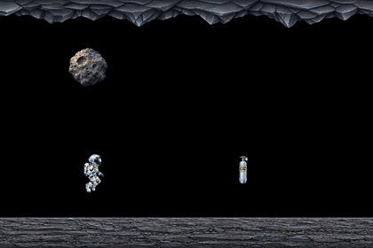
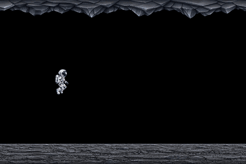
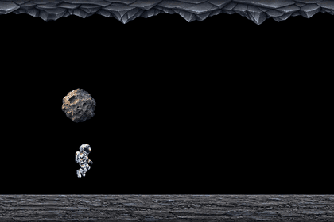
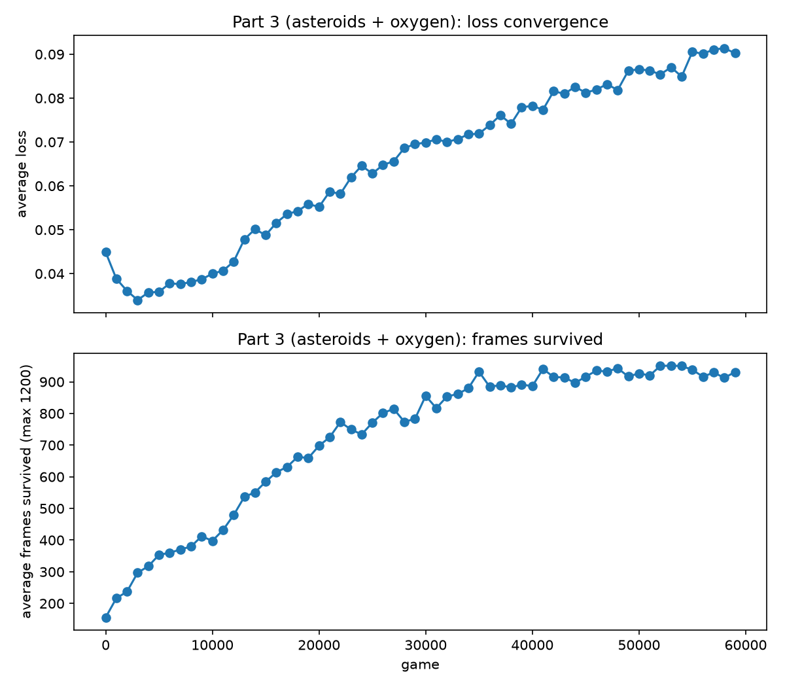

# Astronaut Q-Learning

A tabular Q-learning agent that learns to keep an astronaut alive in the [famnit-gym](https://github.com/DomenSoberlFamnit/famnit-gym) **Astronaut** environment. The agent learns three versions of the game, each harder than the last: the plain game, then with asteroids, then with asteroids and oxygen tanks to collect.

<p align="center">
  
</p>

## Results

Each agent is tested on 50 games it never saw during training (seeds `100000`–`100049`). A game lasts at most 1200 frames.

| Part | Environment | Training games | Mean frames (trained) | Full games survived | Mean frames (random) |
|------|-------------|---------------:|----------------------:|--------------------:|---------------------:|
| 1 | Plain | 3,000 | **1200.0** | 50 / 50 | 143.7 |
| 2 | + Asteroids | 15,000 | **1180.5** | 48 / 50 | 112.2 |
| 3 | + Asteroids + Oxygen | 60,000 | **1035.8** | 36 / 50 | 112.2 |

In part 3 the trained agent collects **5.7 oxygen tanks** per game on average. The random agent collects none.

| Part 1: Plain | Part 2: Asteroids | Part 3: Asteroids + Oxygen |
|:---:|:---:|:---:|
|  |  |  |
| [Full video](docs/media/plain.mp4) | [Full video](docs/media/asteroids.mp4) | [Full video](docs/media/oxygen.mp4) |

## Method

- **State:** continuous observations are split into bins. The bins are the astronaut's height (12) and vertical speed (10), the relative position of the nearest asteroid (6 × 10), and the relative position of the nearest oxygen tank (3 × 6).
- **Actions:** thrust on or off. Each action is held for 6 frames.
- **Learning:** α = 0.1, γ = 0.99, ε-greedy exploration with ε = 0.1.
- **Reward (part 3):** −1 for a crash, +1 for picking up an oxygen tank, 0 otherwise.
- **Reproducibility:** all randomness is seeded. Training game `i` uses `env.reset(seed=i)`, so a rerun gives the same results.

<p align="center">
  
</p>

## Project structure

```
.
├── src/
│   ├── explore.py                 # random play, used to choose state ranges
│   ├── train_no_wrapper.py        # part 1
│   ├── train_asteroids.py         # part 2
│   ├── train_asteroids_oxygen.py  # part 3
│   ├── watch_asteroids.py         # watch the trained part 2 agent
│   ├── watch_asteroids_oxygen.py  # watch the trained part 3 agent
│   └── graph.py                   # plot loss and survival curves
├── results/
│   ├── logs/                      # per-episode loss and frames survived
│   ├── qtables/                   # trained Q-tables (.npy)
│   └── plots/                     # training curves
├── docs/
│   ├── poster.pdf
│   └── media/                     # screenshots, GIFs and videos
└── requirements.txt
```

## Getting started

```bash
git clone https://github.com/ermi9/astronaut-ql.git
cd astronaut-ql
python3 -m venv .venv && source .venv/bin/activate
pip install -r requirements.txt
```

Run every script from the repository root:

```bash
python src/train_no_wrapper.py         # about 20 s
python src/train_asteroids.py          # about 2 min
python src/train_asteroids_oxygen.py   # about 18 min

python src/watch_asteroids_oxygen.py   # opens a window with the trained agent
python src/graph.py                    # set name/title/block_size at the top first
```

Training overwrites the files in `results/logs` and `results/qtables`. The viewer scripts load the saved Q-tables, so you can watch the trained agents without training first.

## Poster

The full write-up, including the crash-penalty and training-length experiments, is in [docs/poster.pdf](docs/poster.pdf).
